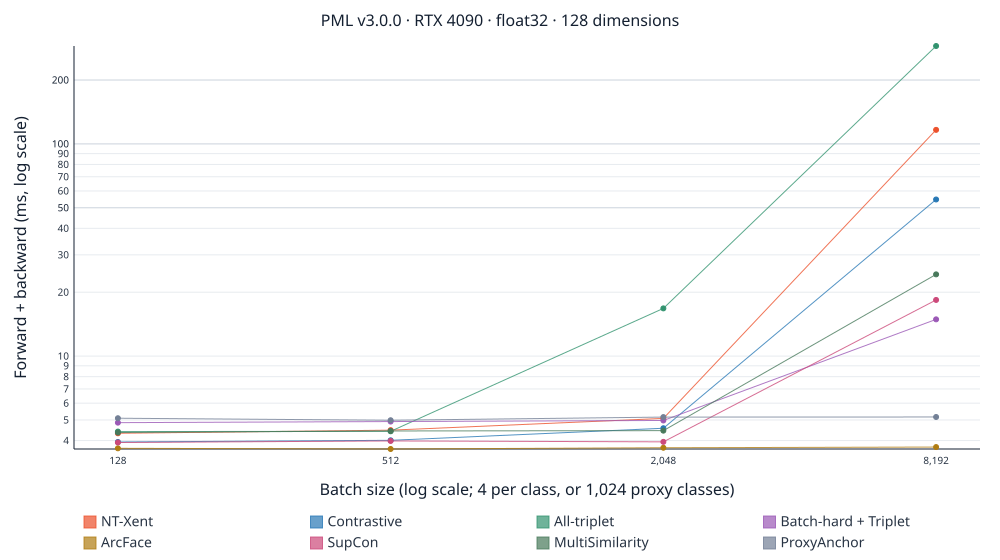
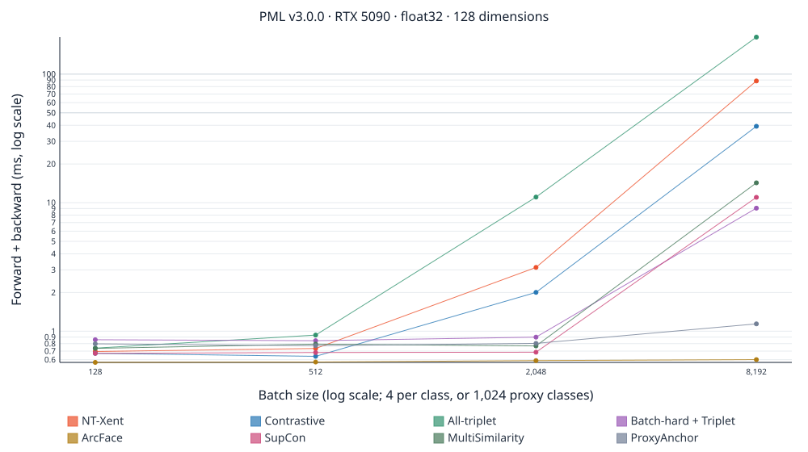
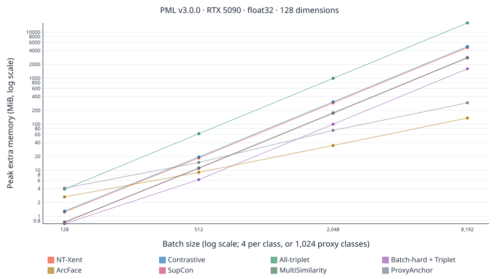
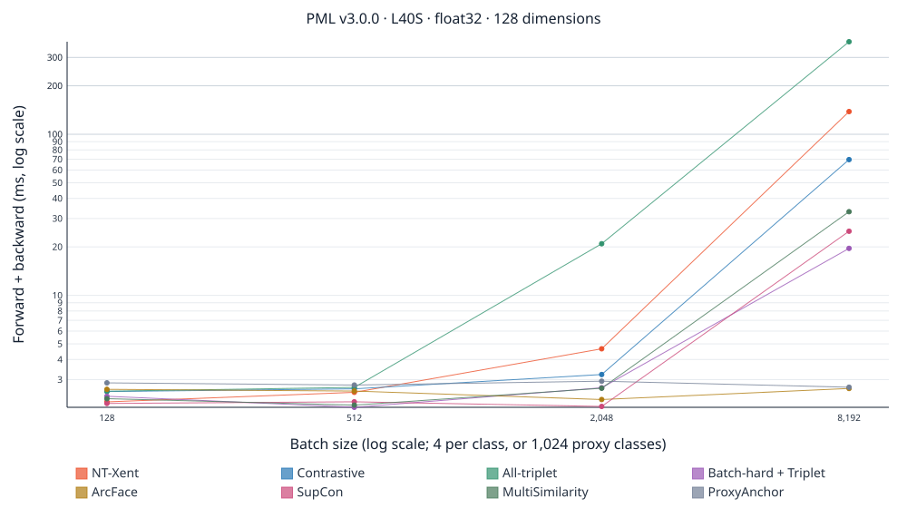
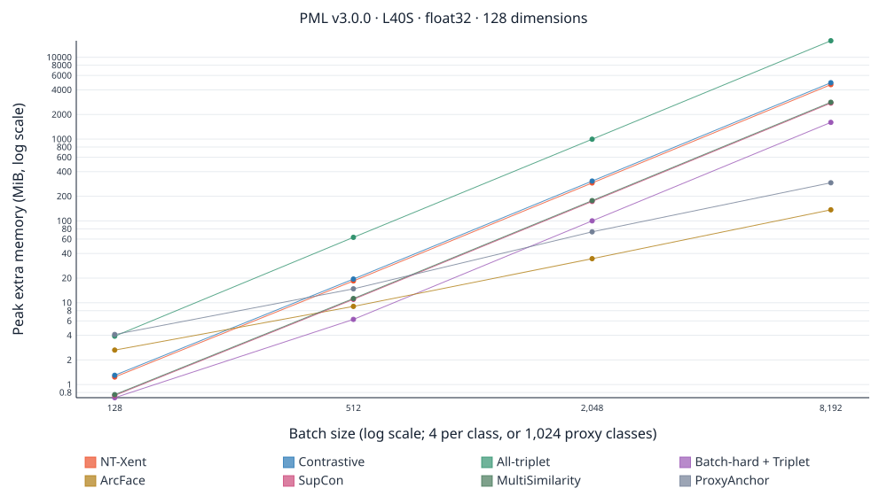
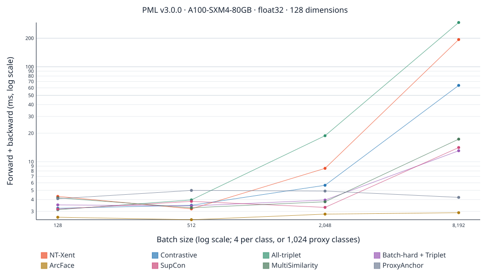
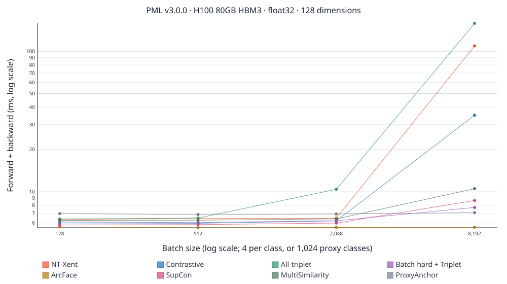
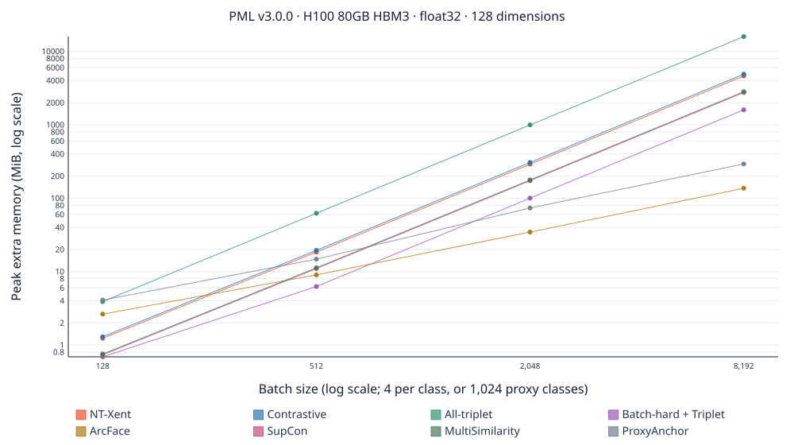

# PML 3.0.0 GPU benchmarks

For the current release, see the [3.0.1 timings and memory measurements](low-precision-fix/README.md) and [performance overview](../../performance.md). The measurements below compare the original v3.0.0 release with v2.9.0.

Released v3.0.0 and v2.9.0, measured on the same GPU and software stack. These are loss/miner forward and backward measurements; encoder, optimizer, data loading, compilation, anchor batching, and distributed training are excluded.

All overview tables use float32, batch 512, and 128-dimensional seeded standard-normal embeddings. Pair/triplet objectives use four samples per class. ArcFace and ProxyAnchor have 1,024 fixed proxy classes and cyclic class labels. [Full measurements](https://github.com/KevinMusgrave/pytorch-metric-learning/blob/v3.0.1/docs/benchmarks/gpu-3.0.0/measurements.csv) include the 512-dimensional, sixteen-per-class profile with 10,000 proxy classes, all batch sizes, BF16, and process ranges.

## Hardware and software

| GPU            | GPU memory (GiB) | Host CPU                            | PyTorch      | CUDA |
| -------------- | ---------------: | ----------------------------------- | ------------ | ---- |
| RTX 4090       |            23.52 | AMD EPYC 7352 24-Core Processor     | 2.14.0+cu130 | 13.0 |
| RTX 5090       |            31.36 | AMD Ryzen 9 9950X 16-Core Processor | 2.14.0+cu130 | 13.0 |
| L40S           |            44.39 | AMD EPYC 9354 32-Core Processor     | 2.14.0+cu130 | 13.0 |
| A100-SXM4-80GB |            79.25 | AMD EPYC 7742 64-Core Processor     | 2.14.0+cu130 | 13.0 |
| H100 80GB HBM3 |            79.18 | Intel(R) Xeon(R) Platinum 8470      | 2.14.0+cu130 | 13.0 |

Memory is the total exposed by PyTorch, before the 90% capacity budget. Small eager workloads also depend on the host CPU; these results compare complete rented systems, not GPU silicon alone. Per-GPU provenance below includes Python, driver, power limits, clocks, timestamps, and precision settings.

## Version 3.0.0 speed

Milliseconds per forward/backward pair. Three process means, each averaging three blocks of 100 pairs after warmup; synchronization occurs only at block boundaries. Lower is better.

| Loss                 | RTX 4090 | RTX 5090 | L40S | A100-SXM4-80GB | H100 80GB HBM3 |
| -------------------- | -------: | -------: | ---: | -------------: | -------------: |
| NT-Xent              |     4.48 |    0.733 |  2.5 |           3.19 |           6.44 |
| Contrastive          |     4.01 |    0.637 | 2.63 |           3.48 |           5.94 |
| All-triplet          |     4.42 |    0.933 | 2.68 |           3.97 |           6.49 |
| Batch-hard + Triplet |     4.91 |    0.843 | 2.02 |           3.43 |           6.02 |
| ArcFace              |     3.65 |    0.575 | 2.55 |           2.45 |           5.53 |
| SupCon               |     3.98 |    0.682 | 2.18 |           3.83 |           5.82 |
| MultiSimilarity      |     4.44 |    0.793 | 2.08 |           3.28 |           6.26 |
| ProxyAnchor          |     4.99 |    0.771 | 2.78 |           4.99 |           6.86 |

## Version 3.0.0 memory

Steady-state peak PyTorch allocation in MiB, including inputs, parameters, retained workspaces, and temporary tensors. Lower is better. Incremental allocation and allocator reservation are separate columns in the CSV; this is not total device usage.

| Loss                 | RTX 4090 | RTX 5090 | L40S | A100-SXM4-80GB | H100 80GB HBM3 |
| -------------------- | -------: | -------: | ---: | -------------: | -------------: |
| NT-Xent              |       35 |     82.7 |   35 |             35 |           82.7 |
| Contrastive          |       36 |     83.7 |   36 |             36 |           83.7 |
| All-triplet          |     79.5 |      127 | 79.5 |           79.5 |            127 |
| Batch-hard + Triplet |     22.8 |     70.5 | 22.8 |           22.8 |           70.5 |
| ArcFace              |       26 |     73.8 |   26 |             26 |           73.8 |
| SupCon               |     27.5 |     75.3 | 27.5 |           27.5 |           75.3 |
| MultiSimilarity      |     27.8 |     75.5 | 27.8 |           27.8 |           75.5 |
| ProxyAnchor          |     31.8 |     79.5 | 31.8 |           31.8 |           79.5 |

## Batch capacity: v2.9 → v3.0

Largest verified batch under a 90% GPU tensor-allocation budget, with 128-dimensional float32 embeddings and the standard label/proxy configuration, using ordinary full loss calls and backward passes. Each successful boundary passed three fresh processes. Searches stop within 128 rows or 5% of a failing batch. ≥ marks the search ceiling, not a hardware limit. Per-GPU provenance files retain the failing batch and distinguish OOM, indexing, nonfinite, and timeout limits. This is loss-only capacity; a training model needs additional memory.

| Loss                 |                RTX 4090 |                RTX 5090 |                    L40S |          A100-SXM4-80GB |          H100 80GB HBM3 |
| -------------------- | ----------------------: | ----------------------: | ----------------------: | ----------------------: | ----------------------: |
| NT-Xent              |            640 → 17,408 |            768 → 19,968 |            768 → 23,552 |          1,024 → 31,744 |          1,024 → 31,744 |
| Contrastive          |         16,384 → 16,384 |         19,456 → 19,456 |         23,552 → 23,552 |         30,720 → 30,720 |         30,720 → 30,720 |
| All-triplet          |           8,960 → 9,216 |         10,240 → 10,752 |         12,288 → 12,800 |         16,384 → 16,896 |         16,384 → 16,896 |
| Batch-hard + Triplet |         27,648 → 29,696 |         30,720 → 33,792 |         37,888 → 40,960 |         51,200 → 55,296 |         49,152 → 53,248 |
| ArcFace              | ≥1,048,576 → ≥1,048,576 | ≥1,048,576 → ≥1,048,576 | ≥1,048,576 → ≥1,048,576 | ≥1,048,576 → ≥1,048,576 | ≥1,048,576 → ≥1,048,576 |
| SupCon               |         21,504 → 20,480 |         24,576 → 25,600 |         29,696 → 30,720 |         38,912 → 40,960 |         38,912 → 40,960 |
| MultiSimilarity      |         20,480 → 21,504 |         23,552 → 25,600 |         28,672 → 30,720 |         37,888 → 40,960 |         37,888 → 40,960 |
| ProxyAnchor          |       491,520 → 720,896 |       655,360 → 983,040 |    917,504 → ≥1,048,576 | ≥1,048,576 → ≥1,048,576 | ≥1,048,576 → ≥1,048,576 |

## Time ratio: v2.9 / v3.0

Above 1 means v3 is faster; below 1 means slower. † means the ranges of the three process means overlap, so the measured difference is not treated as established.

| Loss                 | RTX 4090 | RTX 5090 |    L40S | A100-SXM4-80GB | H100 80GB HBM3 |
| -------------------- | -------: | -------: | ------: | -------------: | -------------: |
| NT-Xent              |    9.16× |    33.5× |   22.7× |          7.68× |          2.28× |
| Contrastive          |    1.27× |    1.28× |   1.41× |         1.16׆ |           1.2× |
| All-triplet          |  0.979׆ |    1.46× |   1.23× |         1.08׆ |         0.953× |
| Batch-hard + Triplet |    1.09× |   1.23׆ |   1.37× |         1.36׆ |          1.17× |
| ArcFace              |    1.13× |    1.17× |   1.17× |         1.32׆ |          1.08× |
| SupCon               |    1.09× |   1.18׆ |   1.15× |          1.17× |           1.1× |
| MultiSimilarity      |  0.994׆ |  0.892׆ |  1.08׆ |         1.04׆ |        0.973׆ |
| ProxyAnchor          |   0.954× |   1.07׆ | 0.902׆ |         0.777× |         0.955× |

## Memory ratio: v2.9 / v3.0

Ratio of peak PyTorch allocation. Above 1 means v3 uses less memory.

| Loss                 | RTX 4090 | RTX 5090 |  L40S | A100-SXM4-80GB | H100 80GB HBM3 |
| -------------------- | -------: | -------: | ----: | -------------: | -------------: |
| NT-Xent              |     186× |    79.2× |  186× |           186× |          79.2× |
| Contrastive          |       1× |       1× |    1× |             1× |             1× |
| All-triplet          |    2.07× |    1.67× | 2.07× |          2.05× |          1.67× |
| Batch-hard + Triplet |    1.04× |    1.01× | 1.04× |          1.04× |          1.01× |
| ArcFace              |    1.01× |       1× | 1.01× |          1.01× |             1× |
| SupCon               |    1.03× |    1.01× | 1.03× |          1.03× |          1.01× |
| MultiSimilarity      |    1.07× |    1.03× | 1.07× |          1.07× |          1.03× |
| ProxyAnchor          |    1.24× |    1.09× | 1.24× |          1.24× |          1.09× |

## Larger embeddings and more positives

Time ratios at batch 512, 512 dimensions, sixteen samples per class (10,000 classes for proxy losses). Failed v2 runs are shown explicitly rather than assigned an infinite speedup.

| Loss                 | RTX 4090 | RTX 5090 |    L40S | A100-SXM4-80GB | H100 80GB HBM3 |
| -------------------- | -------: | -------: | ------: | -------------: | -------------: |
| NT-Xent              | oom → ok | oom → ok |     92× |          27.2× |          10.4× |
| Contrastive          |    1.27× |   1.16׆ |   1.55× |         1.24׆ |          1.17× |
| All-triplet          |    1.15× |    1.59× |   1.54× |          1.49× |          1.05× |
| Batch-hard + Triplet |    1.15× |    1.13× |   1.22× |          1.38× |          1.18× |
| ArcFace              |    1.11× |    1.18× |   1.32× |         1.08׆ |          1.11× |
| SupCon               |    1.11× |  0.997׆ |   1.31× |         1.02׆ |         1.06׆ |
| MultiSimilarity      |  0.982׆ |   1.08׆ | 0.932׆ |        0.943׆ |         0.946× |
| ProxyAnchor          |   0.957× |    1.08× |  0.844× |         1.06׆ |        0.966׆ |

## Version 3.0.0 BF16

Milliseconds per pair at batch 512 in the standard profile. Inputs and parameters are BF16 directly; this is not an autocast or end-to-end mixed-precision training benchmark. Finite checks are required, but the cross-version full-gradient agreement check is float32.

| Loss                 | RTX 4090 | RTX 5090 | L40S | A100-SXM4-80GB | H100 80GB HBM3 |
| -------------------- | -------: | -------: | ---: | -------------: | -------------: |
| NT-Xent              |     4.85 |    0.738 | 3.39 |           4.14 |           6.96 |
| Contrastive          |     4.19 |     0.98 | 2.88 |           3.46 |           5.93 |
| All-triplet          |     4.34 |     1.42 |  2.5 |           3.91 |           6.24 |
| Batch-hard + Triplet |     4.87 |     1.32 | 2.29 |           4.03 |           6.07 |
| ArcFace              |     4.04 |    0.669 | 2.84 |           3.64 |           5.19 |
| SupCon               |     3.88 |    0.739 | 2.42 |           2.97 |           6.19 |
| MultiSimilarity      |     4.61 |    0.723 | 2.79 |           3.98 |           6.64 |
| ProxyAnchor          |     5.55 |    0.851 |  3.1 |           4.67 |           7.43 |

### BF16 at batch 2,048

Released v3.0.0 has major BF16 time and memory regressions for Contrastive and batch-hard triplet at this size. Their low-precision Euclidean distance uses the direct CUDA kernel to preserve nearby-point accuracy; its backward pass allocates a batch-by-batch-by-dimension buffer. These release measurements retain that behavior. See the [subsequent fix experiment](../../performance.md#low-precision-distance-fix) for a separately measured correction included in v3.0.1.

Milliseconds per forward/backward pair:

| Loss                 | RTX 4090 | RTX 5090 | L40S | A100-SXM4-80GB | H100 80GB HBM3 |
| -------------------- | -------: | -------: | ---: | -------------: | -------------: |
| NT-Xent              |     5.33 |     3.13 | 4.68 |           8.58 |           6.87 |
| Contrastive          |     17.6 |     13.3 | 20.5 |           23.4 |           14.1 |
| All-triplet          |     30.8 |     21.9 | 37.2 |           36.8 |           20.7 |
| Batch-hard + Triplet |     20.5 |     16.2 | 22.9 |           29.9 |           18.9 |
| ArcFace              |        4 |     0.65 | 2.69 |            3.1 |           5.82 |
| SupCon               |     4.18 |    0.712 | 2.48 |           3.21 |            6.3 |
| MultiSimilarity      |     4.64 |    0.771 | 2.66 |           4.07 |            6.5 |
| ProxyAnchor          |     5.61 |    0.904 | 3.19 |           4.73 |            7.6 |

Peak PyTorch allocation in MiB:

| Loss                 | RTX 4090 | RTX 5090 |  L40S | A100-SXM4-80GB | H100 80GB HBM3 |
| -------------------- | -------: | -------: | ----: | -------------: | -------------: |
| NT-Xent              |      292 |      339 |   292 |            292 |            339 |
| Contrastive          |    2,118 |    2,118 | 2,118 |          2,118 |          2,374 |
| All-triplet          |    2,118 |    2,118 | 2,118 |          2,118 |          2,374 |
| Batch-hard + Triplet |    2,118 |    2,118 | 2,118 |          2,118 |          2,374 |
| ArcFace              |     35.8 |     83.6 |  35.8 |           35.8 |           83.6 |
| SupCon               |      158 |      206 |   158 |            158 |            206 |
| MultiSimilarity      |      146 |      194 |   146 |            146 |            194 |
| ProxyAnchor          |     67.3 |      115 |  67.3 |           67.3 |            115 |

Time ratio, v2.9 / v3.0; below 1 means v3 is slower:

| Loss                 | RTX 4090 | RTX 5090 |     L40S | A100-SXM4-80GB | H100 80GB HBM3 |
| -------------------- | -------: | -------: | -------: | -------------: | -------------: |
| NT-Xent              | oom → ok | oom → ok | oom → ok |       oom → ok |       oom → ok |
| Contrastive          |   0.311× |   0.189× |   0.206× |          0.32× |         0.527× |
| All-triplet          |      15× |     6.8× |    7.57× |          13.7× |          13.5× |
| Batch-hard + Triplet |   0.263× |  0.0583× |   0.124× |         0.158× |         0.382× |
| ArcFace              |    1.03× |   1.14׆ |    1.15× |         1.16׆ |          1.06× |
| SupCon               |    1.06× |    1.14× |   1.05׆ |         1.15׆ |          1.02× |
| MultiSimilarity      |    0.95× |   0.903× |   0.902× |        0.894׆ |        0.955׆ |
| ProxyAnchor          |   0.886× |   0.813× |   0.844× |        0.723׆ |         0.886× |

## Scaling and raw evidence

The charts show successful v3 float32 points in the standard profile. Memory charts show additional peak allocation above the warmed pre-forward allocation, excluding inputs, parameters, and workspaces already resident at that point. A missing point is a failed run, not zero cost; consult the CSV for its status. GPU and host CPU both affect small eager workloads. These rented machines were not isolated from host contention; process ranges quantify observed variation, not a universal performance guarantee.

### RTX 4090

[Raw measurements](https://github.com/KevinMusgrave/pytorch-metric-learning/blob/v3.0.1/docs/benchmarks/gpu-3.0.0/gpu-1-raw.jsonl.gz) · [Hardware and validation evidence](https://github.com/KevinMusgrave/pytorch-metric-learning/blob/v3.0.1/docs/benchmarks/gpu-3.0.0/gpu-1-provenance.json)

### RTX 5090

[Raw measurements](https://github.com/KevinMusgrave/pytorch-metric-learning/blob/v3.0.1/docs/benchmarks/gpu-3.0.0/gpu-2-raw.jsonl.gz) · [Hardware and validation evidence](https://github.com/KevinMusgrave/pytorch-metric-learning/blob/v3.0.1/docs/benchmarks/gpu-3.0.0/gpu-2-provenance.json)

### L40S

[Raw measurements](https://github.com/KevinMusgrave/pytorch-metric-learning/blob/v3.0.1/docs/benchmarks/gpu-3.0.0/gpu-3-raw.jsonl.gz) · [Hardware and validation evidence](https://github.com/KevinMusgrave/pytorch-metric-learning/blob/v3.0.1/docs/benchmarks/gpu-3.0.0/gpu-3-provenance.json)

### A100-SXM4-80GB

[Raw measurements](https://github.com/KevinMusgrave/pytorch-metric-learning/blob/v3.0.1/docs/benchmarks/gpu-3.0.0/gpu-4-raw.jsonl.gz) · [Hardware and validation evidence](https://github.com/KevinMusgrave/pytorch-metric-learning/blob/v3.0.1/docs/benchmarks/gpu-3.0.0/gpu-4-provenance.json)

### H100 80GB HBM3

[Raw measurements](https://github.com/KevinMusgrave/pytorch-metric-learning/blob/v3.0.1/docs/benchmarks/gpu-3.0.0/gpu-5-raw.jsonl.gz) · [Hardware and validation evidence](https://github.com/KevinMusgrave/pytorch-metric-learning/blob/v3.0.1/docs/benchmarks/gpu-3.0.0/gpu-5-provenance.json)

## Reproduce

See [the benchmark protocol](../../performance.md#systematic-release-comparison) and the checked-in `benchmarks/release.json` matrix. Raw evidence records the exact library commits, benchmark commit, GPU, driver, Python/PyTorch/CUDA versions, inputs, settings, and block averages.
